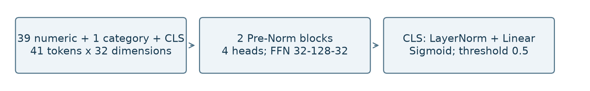
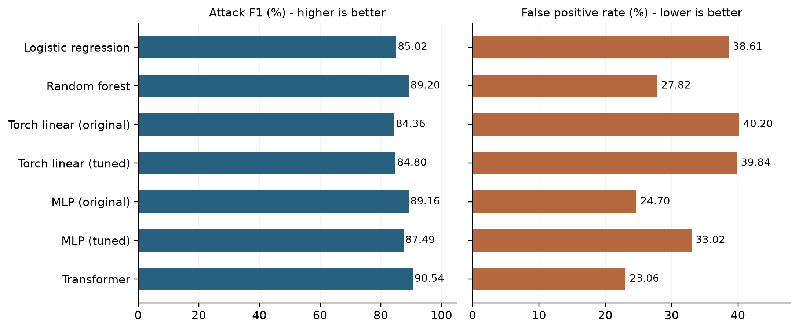
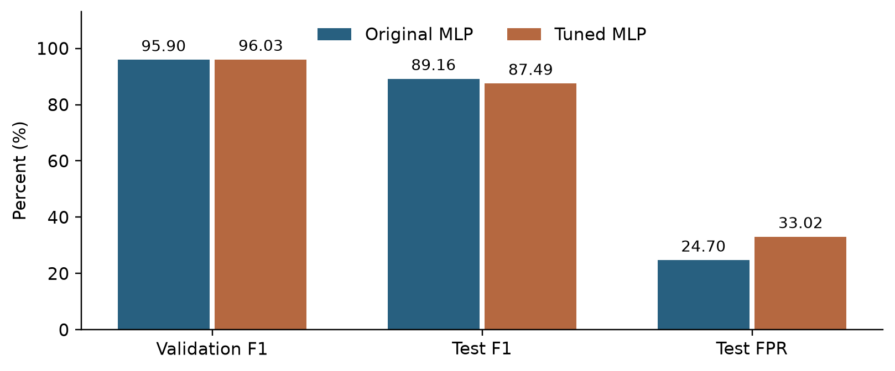
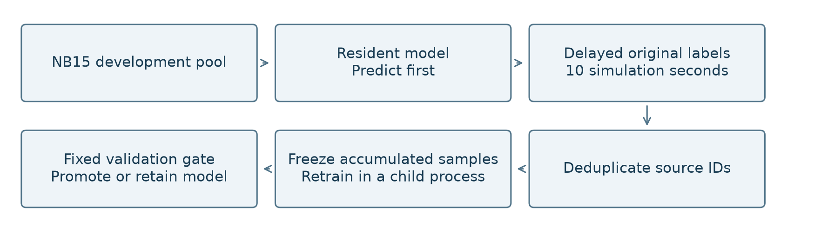
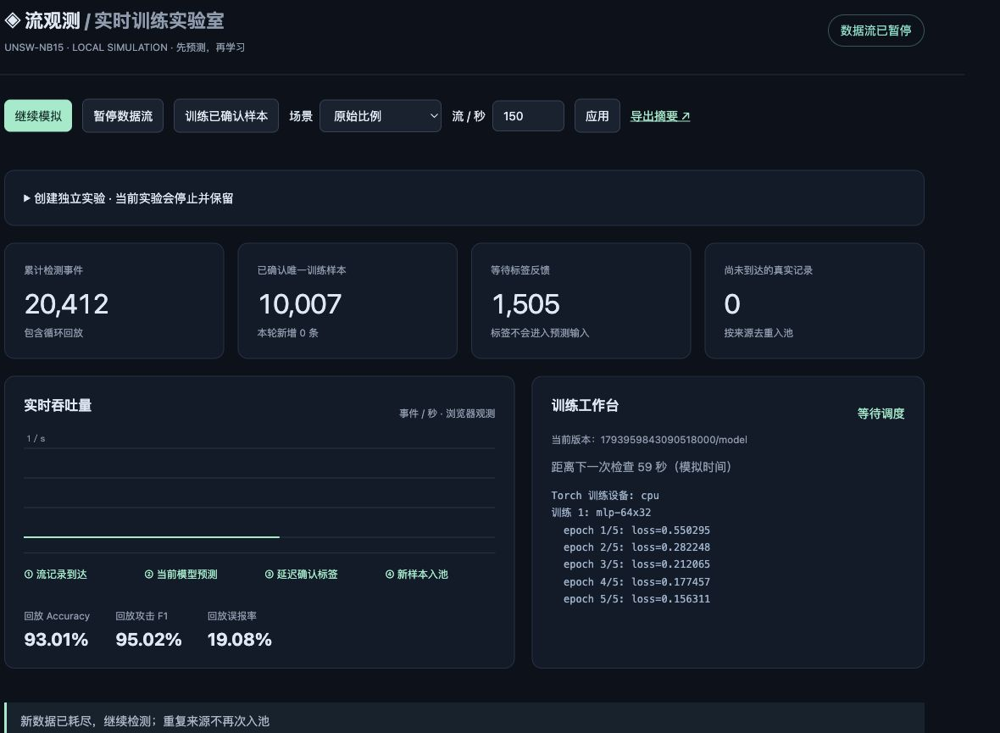
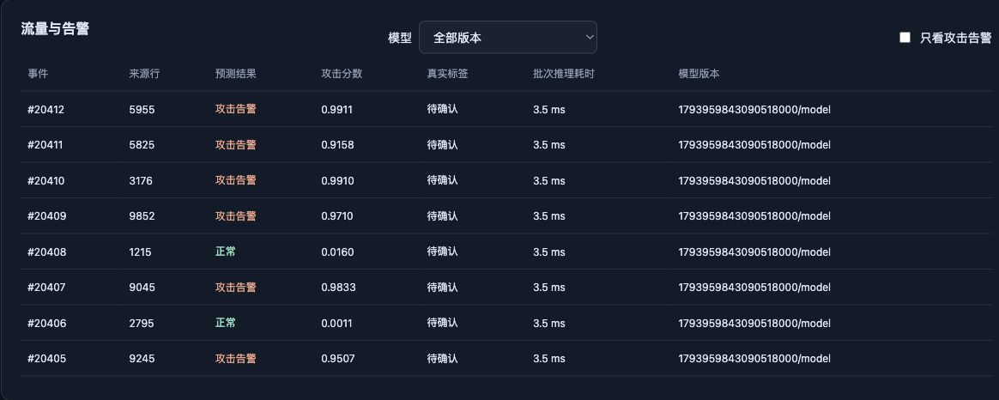
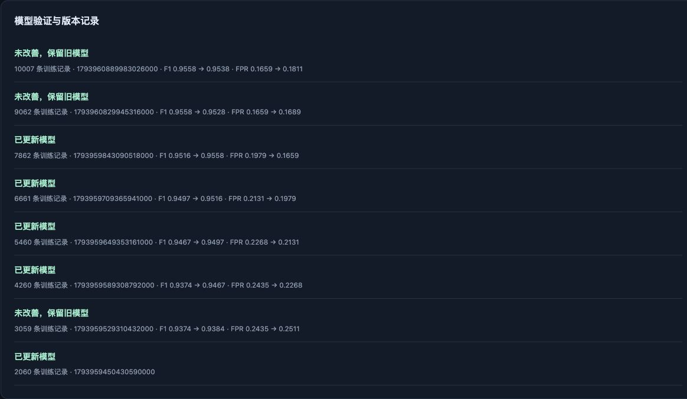

# 摘要

本项目面向网络流量正常/攻击二分类，完成了从公开数据获取、特征审计、训练与验证、模型保存到独立推理的实验系统，并实现由 CLI 启动、长期运行的本地 Web Dashboard。系统使用 UNSW-NB15 的预定义训练/测试角色，在隔离冲突标签和跨集合重复特征后，以 131,706 条记录训练、32,927 条记录验证，在固定的 82,332 条测试记录上比较逻辑回归、随机森林、Torch 线性模型、MLP 与轻量表格 Transformer。

在已完成的模型族评估中，轻量 Transformer 的测试 Accuracy 为 88.69%、攻击类 F1 为 90.54%、误报率为 23.06%。随机森林与原 MLP 的 F1 分别为 89.20% 和 89.16%。调参 MLP 的验证 F1 略升，但测试 F1 降至 87.49%，说明验证集上的微小提升不能直接等同于泛化改善。报告保留调参前后结果，不以测试成绩重新选择候选；2026-11-05 调参实验的整体验证获选模型仍为 MLP。

实时部分以真实开发集记录模拟特征流到达：常驻模型先预测，延迟揭示标签，按来源去重入池，定时冻结累计样本并在独立进程重训，通过固定验证门槛后切换模型。历史演示包含 20,412 次检测事件和 8 次训练任务，验证了候选接受与拒绝路径。回放包含重复事件，其指标不作为独立测试效果。系统适用于课程实验和机制展示，尚无真实网络采集或生产部署证据。

关键词：网络入侵检测；UNSW-NB15；MLP；表格 Transformer；持续学习模拟；模型验证。

阅读入口：[最终 PDF](final/report.pdf)、[独立 LaTeX 源文件](final/report.tex)、[报告构建说明](final/README.md)。本报告为公开版，不含个人姓名、学号和 PPT。实验主要完成于 2026 年 11 月 3 日至 6 日，本版整理与工程验证日期为 2026 年 11 月 13 日。

# 问题定义与系统需求

每条输入是一行已提取的流量特征，而非原始报文或任意系统日志。输入包含 39 个数值字段和 3 个类别字段；输出为正常/攻击标签以及攻击概率，标签映射为正常 0、攻击 1，攻击为正类。预测概率是模型输出，尚未进行概率校准。

系统的离线流程为 `prepare → train → evaluate / predict`，在线形式的模拟入口为 `serve`。需求包括：预处理仅拟合训练集；候选仅由验证集选择；模型能在新进程独立加载；无标签输入可分批预测；异常输入给出明确错误；运行状态、训练记录及模型版本可追溯。模拟模式还要求模型常驻内存、训练不阻塞检测、延迟标签不提前用于学习、重启后能恢复实验。

当前实现不执行实时抓包，也不从报文计算特征。模拟器重放已有真实记录，不生成新的独立网络样本。定时训练是在累计已确认样本上从头重新拟合模型，不是对每条到达记录立即执行增量梯度更新。合成数据仅用于自动化测试，未用于正式检测效果结论。

# 数据集、特征与防泄漏处理

## 来源与字段

UNSW 官方介绍的预定义训练集为 175,341 行，测试集为 82,332 行，包含正常流量及九类攻击背景；本实验把攻击统一映射为正类，未实现九类攻击的多分类识别。原始全量数据的 49 字段说明与预定义划分 CSV 的 45 列布局不同，本项目使用后者的 42 个输入字段。[官方数据页](https://research.unsw.edu.au/projects/unsw-nb15-dataset)提供数据说明与引用要求。

2026-11-03 获取时官方下载入口要求登录，实际使用固定版本的 [Mireu-Lab 镜像](https://huggingface.co/datasets/Mireu-Lab/UNSW-NB15/tree/3eb02c4a0a29866b7abcb5ef77c45cf4fcc8f6b0)。该镜像的 `test.csv` 对应本项目训练角色，`train.csv` 对应测试角色；映射依据行数、类别分布与镜像间哈希交叉核验。原始下载字节不变，只重命名文件；尚未与官方原始文件完成逐字节核验。完整 SHA-256、字段含义、授权范围及下载方式见 [数据说明](dataset.md)，本仓库不分发完整数据集。

`proto`、`service`、`state` 为类别字段。数值字段包括持续时间、包数、字节数、速率、TTL、丢包、窗口、时延、抖动及邻近连接统计。`id`、`label`、`attack_cat` 不作为特征；`source_file`、`source_row` 只用于追溯。攻击类别只用于评估后的错误细分，不能从中派生训练输入。

## 审计与划分

原始训练角色中，同特征冲突标签涉及 229 组、940 行；测试角色有 6 组、14 行。默认严格策略会拒绝冲突。正式配置显式采用 `quarantine_development`，隔离训练侧冲突记录，完整保留测试侧冲突记录，并保留来源清单。随后移除开发集中与测试集特征完全相同的 9,768 行，得到 164,633 行开发数据。

使用固定字段顺序和规范类型计算特征指纹，以种子 42 的 `StratifiedGroupKFold(n_splits=5)` 第一折作为验证集。同一特征组不跨训练/验证；同标签的组内重复记录仍保留，不能声称重复样本影响已全部消除。

| 集合 | 总行数 | 正常 | 攻击 | 用途 |
|---|---:|---:|---:|---|
| 训练 | 131706 | 43237 | 88469 | 拟合预处理和分类模型 |
| 验证 | 32927 | 10809 | 22118 | 选择候选，不参与拟合 |
| 测试 | 82332 | 37000 | 45332 | 冻结候选后的效果评估 |

三个实验批次的划分文件 SHA-256 相同，见 [历史清单](results/full-20261103/data/manifest.json)、[Torch 清单](results/torch-full-20261105/data/manifest.json)和[调参清单](results/torch-tune-20261105/data/manifest.json)。因此结果可在这一固定基准上比较，但不构成不同训练方法的等预算因果实验。

## 预处理与有效性边界

Torch 模型使用 `ColumnTransformer`：数值字段以训练集中位数填充并标准化，类别字段 One-Hot 编码；未知类别允许编码但记录数量。变换器只在训练集拟合，并与分类器共同构成 Pipeline。完整训练集拟合后输入维度为 193，其中数值 39 维、类别编码 154 维。历史逻辑回归同样标准化，随机森林不依赖数值标准化；历史实现以其原始配置和代码为准。

CSV 缺少可靠时间、原始 IP、主机和会话键，不能证明这些层面的隔离。TTL、TCP 序列号和连接聚合统计可能反映实验室采集环境，聚合窗口无法由当前 CSV 重建。测试特征曾用于重叠审计，虽未用于拟合和选参，仍有别于完全不接触测试输入的协议。指纹分组还存在极低概率的哈希碰撞风险。

# 系统设计与模型结构

## 模块与数据流

数据模块负责字段契约、审计和划分；训练模块负责 Pipeline 拟合、验证选择、评估及持久化；推理模块负责可信模型加载、输入校验和分批预测；模拟引擎负责到达调度、反馈标签、训练进程、状态持久化和模型切换；FastAPI 与前端负责展示和控制。

离线实验按候选逐个训练，成功候选进入验证排序。每次运行建立新目录，记录配置、数据与代码哈希、依赖和成功/失败状态。生产式模拟通过后台线程运行事件循环，Web 请求经命令队列进入引擎；训练在子进程进行，检测继续使用旧模型。模型通过验证门槛并成功加载、预热后才替换内存中的模型引用。

## 逻辑回归、Torch 线性模型与随机森林

逻辑回归和 Torch 线性模型都计算单个线性 logit，再经过 Sigmoid：

$$p(y=1\mid x)=\sigma(w^\mathsf{T}x+b),\qquad \sigma(z)=\frac{1}{1+e^{-z}}.$$

两者并不是同一次实验：历史逻辑回归使用 scikit-learn 的 `lbfgs` 求解器，族内获选参数为 `C=10`、不加权；Torch 线性模型是 `Linear(193,1)`，由 AdamW 和二元交叉熵训练。相同函数形式不意味着优化器、正则化和有限轮数下的结果相同。

随机森林由 200 棵决策树构成，对每棵树的类别概率求平均后以 0.5 判定。历史获选配置为不限制最大深度、叶节点最少 1 个样本，分裂特征使用 `sqrt`，采用 `balanced_subsample` 类别权重。其结构为“预处理特征 → 多棵树并行判别 → 平均攻击概率”。树的实际深度由拟合数据决定，不将“不限深度”写成固定层数。多数类基线始终预测攻击，用于揭示单看 Recall 的不足。

## MLP 结构与训练

正式原 MLP 和调参 MLP 都使用两层隐藏层，结构如下：

$$193\ \xrightarrow{\mathrm{Linear+ReLU}}\ 128
\ \xrightarrow{\mathrm{Linear+ReLU}}\ 64
\ \xrightarrow{\mathrm{Linear}}\ 1
\ \xrightarrow{\mathrm{Sigmoid}}\ p.$$

原 MLP 不使用 Dropout，训练 20 轮；调参获选版本在每个隐藏层 ReLU 后使用 Dropout 0.1，训练 40 轮。二者均使用学习率 0.001、权重衰减 0.0001、训练批量 512 和不加权 BCEWithLogitsLoss。推理时关闭 Dropout。数据标准化与类别编码保持一致，改进与退化均根据真实指标记录。

模拟服务另使用 MLP 64/32、CPU 2 线程、5 轮、训练批量 256。其输入维度取决于模拟训练池中的类别集合，不能直接套用完整训练集的 193 维；它也不是离线调参获选的 MLP 128/64，更不是 Transformer。

## 轻量表格 Transformer

当前保留的是项目自定义轻量实现，源码见 [transformer.py](../src/ml_network_intrusion_detection/training/transformer.py)。它采用自注意力学习同一条记录内部的特征交互，参考 Transformer 与表格 Transformer 思路，但不是原始机器翻译 Transformer，也不是 FT-Transformer 论文的完整复现。本报告不包含已撤回论文版模型的训练或指标。

39 个标准化数值分别生成带字段身份的 token；154 维类别 One-Hot 向量联合投影成一个类别 token；加上一个可学习 CLS token，共 41 个 token。数值 token 和类别 token 可写为：

$$t_j=x_jw_j+b_j\in\mathbb{R}^{32},\qquad
 t_{\mathrm{cat}}=W_{\mathrm{cat}}x_{\mathrm{onehot}}+b_{\mathrm{cat}}.$$



族内获选网络宽度 32、4 个注意力头、2 个 Pre-Norm 块，单头维度 8。每个块先 LayerNorm，再生成 Q/K/V，执行缩放点积注意力，投影并加残差；随后 LayerNorm、32→128→32 的 GELU 前馈网络及残差。注意力概率、输出投影和前馈网络使用 Dropout 0.1。分类头取最后的 CLS，执行 LayerNorm 和 Linear(32,1)。

$$\operatorname{Attention}(Q,K,V)=\operatorname{softmax}\!\left(\frac{QK^\mathsf{T}}{\sqrt{d_k}}\right)V.$$

输入张量的形状为批量大小 × 41 × 32，注意力矩阵为每个头的 41 × 41；批量中不同流量记录互不做注意力。训练 15 轮、学习率 0.0003、权重衰减 0.0001，网络批量上限 256。相对完整 FT-Transformer，当前类别字段合为单个 token，前馈激活和网络配置也不同，不能以相同名称暗示论文结果已复现。

# 实验协议与候选选择

## 环境与测量口径

正式实验运行于 Apple M1 Pro、8 个逻辑 CPU、16 GiB 内存、macOS arm64；Python 3.12.13、PyTorch 2.15.0、scikit-learn 1.9.1。历史随机森林和逻辑回归使用 CPU，Torch 正式实验使用 MPS，配置 4 个 CPU 算子线程、float32。完整构建信息见各实验目录的 `environment.json`；CUDA 路径已实现但未在 NVIDIA 硬件上验证。

拟合耗时包含预处理、初始化和优化；GPU 计时在结束前同步。预测先预热一批，再对完整测试集预测三次，报告中位数。预测耗时包含 CPU 预处理、数据传输及同步后的模型计算，不包括模型加载、CSV 读写和特征提取；加载耗时单列。CSV 外层批量为 10,000，Transformer 内部网络批量上限 256，其他 Torch 神经模型为 10,000。因此性能反映当前配置，不能据此计算架构无关的 GPU 加速比。

内存每 50 ms 采样 RSS，具体进程/子进程可见性见原始记录；历史 scikit-learn 运行受限于当前进程采样。RSS 包含数据、解释器和分配器保留内存，且候选顺序执行，不是模型净内存或 GPU 显存。MPS 显存峰值没有测量。

## 选择协议与实验批次

所有正式实验固定种子 42 和阈值 0.5。只按验证集攻击 F1 降序、误报率升序、Recall 降序和候选顺序选优。选择冻结后，每个模型族只评估验证获胜候选；不合并训练/验证重拟合，不根据测试成绩替换 `best/`。

| 批次 | 候选范围 | 验证整体获选 | 证据 |
|---|---|---|---|
| 2026-11-03 | 多数类 1、逻辑回归 6、森林 4 | 随机森林 | [历史结果](results/full-20261103/comparison.csv) |
| 2026-11-05 原 Torch | 多数类 1、线性 2、MLP 4 | MLP 128/64，无 Dropout | [原 Torch](results/torch-full-20261105/comparison.csv) |
| 2026-11-05 调参 | 多数类 1、线性 3、MLP 5、Transformer 2 | MLP 128/64，Dropout 0.1 | [调参结果](results/torch-tune-20261105/comparison.csv) |

历史逻辑回归比较 `C={0.1,1,10}` 与是否加权；森林比较最大深度不限/20 和叶节点最少 1/5。原 Torch 比较 MLP 64/32、128/64，以及是否按训练类别计数加权。调参搜索在运行前固定，详见 [search_plan.json](results/torch-tune-20261105/training/search_plan.json)。

调参线性比较学习率、权重衰减及 20/40 轮；MLP 比较 64/32、128/64、256/128、学习率、权重衰减、Dropout 和 20/40 轮；Transformer 比较 16 维/2 头/1 层和 32 维/4 头/2 层，均训练 15 轮。该搜索有限且预算不等，不代表各架构的全局最优比较。

## 调参验证结果

下表为调参批次全部候选的真实验证记录；F1、Recall、FPR 均为百分数。

| 候选 | 验证 F1 | 验证 Recall | 验证 FPR | 拟合秒数 |
|---|---:|---:|---:|---:|
| dummy | 80.36 | 100.00 | 100.00 | 1.01 |
| linear-original | 95.15 | 98.87 | 18.31 | 10.09 |
| linear-lr003-e40 | 95.24 | 98.76 | 17.66 | 17.17 |
| linear-lr01-wd001-e40 | 95.29 | 99.04 | 18.06 | 17.17 |
| mlp-original | 95.90 | 95.96 | 8.54 | 14.79 |
| mlp128-lr0005-wd001-e40 | 95.88 | 98.58 | 14.41 | 32.36 |
| mlp128-drop01-e40 | 96.03 | 98.42 | 13.43 | 21.25 |
| mlp256-drop01-e40 | 95.97 | 98.16 | 13.10 | 27.11 |
| mlp64-lr003-e40 | 95.99 | 97.68 | 11.94 | 21.88 |
| transformer16-l1 | 95.71 | 96.92 | 11.48 | 114.61 |
| transformer32-l2 | 95.84 | 95.49 | 7.74 | 182.98 |

本轮 11 个候选均成功，完整训练、验证与保存共 465.74 秒。整体获选 `mlp128-drop01-e40` 的验证 F1 为 96.03%，高于 Transformer 的 95.84%。训练时 Git 基线为 `fe58aba02978ee7dc7bdb3757e192ad551991982` 且工作区有修改，精确代码依据运行记录中的源码 SHA-256，而不是把基线提交当成全部训练实现。原 Torch 批次的干净训练提交为 `40ae60151fe68049b9a7a7ae2f754a37a169224a`。

# 离线实验结果与分析

## 指标定义

以攻击为正类，混淆矩阵按真实类别为行、预测类别为列，顺序均为正常、攻击：

$$C=\begin{bmatrix}TN&FP\\FN&TP\end{bmatrix}.$$

$$\mathrm{Accuracy}=\frac{TP+TN}{N},\quad
\mathrm{Precision}=\frac{TP}{TP+FP},\quad
\mathrm{Recall}=\frac{TP}{TP+FN}.$$

$$F_1=\frac{2TP}{2TP+FP+FN},\qquad \mathrm{FPR}=\frac{FP}{FP+TN}.$$

宏平均 F1 为正常和攻击两类 F1 的等权平均。ROC-AUC 使用连续分数；Average Precision（AP）按召回增量加权精度，定义为 $\sum_n(R_n-R_{n-1})P_n$，不等同于 PR 曲线梯形面积。零分母等未定义指标在 JSON 中保留 `null` 及原因，不填伪造数值。指标定义参见 [scikit-learn AP 文档](https://scikit-learn.org/stable/modules/generated/sklearn.metrics.average_precision_score.html)。

## 各模型测试对比

以下指标均来自同一 82,332 行测试集，Accuracy、Precision、Recall、F1、FPR 均为百分数。合并表保留每一行的原始结果路径，见 [comparison.csv](final/comparison.csv)。

| 模型 | Accuracy | Precision | Recall | F1 | FPR |
|---|---:|---:|---:|---:|---:|
| 多数类 | 55.06 | 55.06 | 100.00 | 71.02 | 100.00 |
| 逻辑回归 | 81.13 | 75.52 | 97.25 | 85.02 | 38.61 |
| 随机森林 | 86.83 | 81.31 | 98.78 | 89.20 | 27.82 |
| 原 Torch 线性 | 80.23 | 74.70 | 96.90 | 84.36 | 40.20 |
| 调参 Torch 线性 | 80.75 | 75.00 | 97.55 | 84.80 | 39.84 |
| 原 MLP | 87.05 | 82.74 | 96.65 | 89.16 | 24.70 |
| 调参 MLP | 84.45 | 78.55 | 98.71 | 87.49 | 33.02 |
| 轻量 Transformer | 88.69 | 83.93 | 98.28 | 90.54 | 23.06 |



多数类模型的攻击 Recall 为 100%，但误报率同样为 100%，不能作为有效检测器。轻量 Transformer 在已评估模型族中取得最高测试 F1，较原 MLP 高 1.39 个百分点，误报率低 1.64 个百分点；较随机森林 F1 高约 1.34 个百分点，但攻击 Recall 略低。以上是固定基准的描述性结果，不是统计显著性结论，也没有改变已冻结的验证选择。

| 模型 | 宏平均 F1（%） | ROC-AUC | AP |
|---|---:|---:|---:|
| 多数类 | 35.51 | 0.5000 | 0.5506 |
| 逻辑回归 | 79.77 | 0.9561 | 0.9662 |
| 随机森林 | 86.16 | 0.9794 | 0.9826 |
| 原 Torch 线性 | 78.73 | 0.9478 | 0.9615 |
| 调参 Torch 线性 | 79.27 | 0.9550 | 0.9667 |
| 原 MLP | 86.55 | 0.9754 | 0.9819 |
| 调参 MLP | 83.48 | 0.9765 | 0.9827 |
| 轻量 Transformer | 88.24 | 0.9851 | 0.9888 |

Transformer 的 ROC-AUC 和 AP 较高，但固定阈值下仍把约 23% 的正常流量误判为攻击。不能以排序指标替代当前决策阈值下的误报分析。

## MLP 调参前后比较



原 MLP 验证 F1 为 95.8975%，调参后为 96.0277%，提高约 0.13 个百分点；测试 F1 从 89.1557% 降为 87.4873%，下降约 1.67 个百分点；误报率从 24.6973% 升为 33.0162%，上升约 8.32 个百分点。调参模型攻击 Recall 提高至 98.71%，但产生了更多正常流量误报。

这种结果表明本轮调参未改善总体测试表现。单次实验不能区分过拟合、分布差异、有限训练预算或校准误差的因果贡献。保留原模型和真实结果比只报告获选参数更有助于解释泛化边界。测试集已被多轮实验使用，后续改进应在新协议和独立数据上确认。

## 混淆矩阵与攻击类别错误

| 模型 | TN | FP | FN | TP |
|---|---:|---:|---:|---:|
| 随机森林 | 26706 | 10294 | 552 | 44780 |
| 原 MLP | 27862 | 9138 | 1520 | 43812 |
| 调参 MLP | 24784 | 12216 | 584 | 44748 |
| 轻量 Transformer | 28469 | 8531 | 778 | 44554 |

Transformer 相比原 MLP 少误报 607 条正常记录、少漏检 742 条攻击记录。其正常类 Recall 为 76.94%，正常类 F1 为 85.95%；攻击类 Recall 为 98.28%。二分类错误细分如下，检出率指该攻击类别被判为攻击的比例，不表示能够识别其具体攻击名称。

| 攻击背景 | 测试条数 | 检出率（%） | 漏报条数 |
|---|---:|---:|---:|
| Analysis | 677 | 99.85 | 1 |
| Backdoor | 583 | 99.83 | 1 |
| DoS | 4089 | 99.63 | 15 |
| Exploits | 11132 | 99.51 | 55 |
| Fuzzers | 6062 | 88.67 | 687 |
| Generic | 18871 | 99.98 | 3 |
| Reconnaissance | 3496 | 99.60 | 14 |
| Shellcode | 378 | 99.47 | 2 |
| Worms | 44 | 100.00 | 0 |

Fuzzers 仍是主要漏报来源，6,062 条中漏报 687 条，占 Transformer 全部 778 条漏报的大部分。Worms 只有 44 条，即使全部检出也不能据此推断稳定泛化。原始测试冲突标签被保留，相同特征的确定性预测无法同时满足冲突标签。完整结果见 [Transformer 指标](results/torch-tune-20261105/evaluation/transformer/metrics.json)和[类别细分](results/torch-tune-20261105/evaluation/transformer/category_breakdown.csv)。

## 训练、加载与推理成本

| 模型 | 拟合（s） | 加载（s） | 预测（s） | 吞吐（行/s） |
|---|---:|---:|---:|---:|
| 逻辑回归 | 3.345 | 0.1069 | 0.1065 | 773095 |
| 随机森林 | 28.679 | 0.3513 | 0.4954 | 166199 |
| 原 Torch 线性 | 7.806 | 0.0250 | 0.1756 | 468902 |
| 调参 Torch 线性 | 17.171 | 0.0237 | 0.1676 | 491289 |
| 原 MLP | 10.856 | 0.0291 | 0.1865 | 441533 |
| 调参 MLP | 21.248 | 0.0291 | 0.1815 | 453667 |
| 轻量 Transformer | 182.983 | 0.0446 | 3.2356 | 25445 |

表中训练及预测单位为秒，吞吐为行/秒；全部预测覆盖 82,332 行。原 MLP 的耗时取原 Torch 批次，其他模型取对应来源，不能把跨批次波动当成调参的确定收益。Transformer 更高的当前测试 F1 伴随更大计算成本，其完整测试预测约 3.236 秒，调参 MLP 约 0.181 秒。批处理吞吐不是单条网络事件时延，更不是生产链路容量。

独立 CPU 进程已经对原 MLP、调参 MLP、Transformer 的 82,332 行无标签输入验证了加载和预测：标签与行顺序一致，概率在 `atol=1e-6, rtol=1e-5` 内一致。验证对象是同一 CPU 加载方式下的直接预测与分批命令输出，不宣称 CPU 与 MPS 逐位相同。5 条训练未见的 `state` 已统计并正常处理。见 [Transformer 独立验证](results/torch-tune-20261105/verification/transformer/verification.json)。

# 常驻推理、定时训练模拟与前端

## 模拟机制与运行方式

执行 `uv run ml-network-intrusion-detection serve --config configs/simulation.yaml` 后启动本地常驻服务，访问终端给出的地址即可查看 Dashboard。模型加载后保留在进程内存中，对后续记录重复预测；关闭浏览器不停止服务，终端退出则保存状态。它模拟的是已提取特征的到达和标签反馈，而不是监听真实网络接口。



初始化只读取已准备的 `train.csv` 和 `validation.csv` 并核验哈希。训练侧按标签分层抽取完整特征组形成约 10,000 条样本池，其中约 2,000 条用于起始模型；验证侧另取约 2,000 条固定样本。完整组约束使本次实际池大小为 10,007，起始样本为 2,060，固定验证集为 2,000。官方测试文件不进入模拟实验。

| 参数 | 默认/本次配置 | 含义 |
|---|---|---|
| 到达速率 | 初始 20 条/秒，可在 UI 调整 | 历史截图时为 150 条/秒 |
| 标签延迟 | 10 个模拟秒 | 先预测，再揭示原始标签 |
| 调度间隔 | 60 个模拟秒 | 检查是否可以启动新训练 |
| 新样本门槛 | 500 条 | 新增且已确认的来源记录 |
| 模型与训练 | MLP 64/32，5 轮，批量 256 | CPU，2 线程，从头拟合 |
| 切换门槛 | 验证 F1 严格升高且 FPR 不增加 | 两项必须同时满足 |

系统以来源 ID 去重，重复回放不会无限增加训练样本数。任务启动时冻结所有已揭示样本，形成累计训练快照；固定验证集不进入训练。子进程完成后比较新旧模型，在门槛成立、产物加载和预热成功后替换模型，否则保留旧版本。初始模型没有前任，首次成功训练直接装载。

这实现了“新数据不断到达，然后定期训练”的演示闭环，但有限样本池耗尽后只继续检测，来源去重使新样本数不再增加，不会无数据地反复训练。当前没有扰动字段或生成全新模拟样本的模块。原始比例、攻击升高与突发场景改变的是抽样比例和到达节奏，而非网络攻击生成机制。

## 历史演示结果

本节使用 2026-11-06 演示留存的数据库与训练记录，2026-11-13 导出公开版证据。所有训练快照样本数已与 `source_ids` 数量交叉核验，候选决策已与对应 `promotion.json` 核对。证据见 [模拟快照](results/simulation-20261106/snapshot.json)、[实验配置](results/simulation-20261106/experiment.json)和[来源哈希清单](results/simulation-20261106/export_manifest.json)。

| 任务 | 训练行数 | 旧 F1（%） | 候选 F1（%） | 候选 FPR（%） | 决策 |
|---|---:|---:|---:|---:|---:|
| 1 | 2060 | - | - | - | 初始装载 |
| 2 | 3059 | 93.74 | 93.84 | 25.11 | 拒绝 |
| 3 | 4260 | 93.74 | 94.67 | 22.68 | 接受 |
| 4 | 5460 | 94.67 | 94.97 | 21.31 | 接受 |
| 5 | 6661 | 94.97 | 95.16 | 19.79 | 接受 |
| 6 | 7862 | 95.16 | 95.58 | 16.59 | 接受 |
| 7 | 9062 | 95.58 | 95.28 | 16.89 | 拒绝 |
| 8 | 10007 | 95.58 | 95.38 | 18.11 | 拒绝 |

8 次任务包含首次训练、4 次后续接受和 3 次拒绝。3,059 条任务的候选 F1 虽略升，FPR 却从 24.35% 升到 25.11%，因此被拒绝；7,862 条任务同时改善 F1 和 FPR，被接受；9,062 和 10,007 条任务未通过门槛，系统继续使用 7,862 条时的版本。这证明验证门槛实际参与切换，而非训练完成就无条件替换。

快照累计检测事件 20,412 条，其中已获得反馈 18,907 条、待反馈 1,505 条；训练样本按来源去重后为 10,007 条。累计已反馈事件的 TN/FP/FN/TP 为 4,976/1,173/149/12,609，对应回放 Accuracy 93.01%、F1 95.02%、FPR 19.08%。这些事件含重复回放，预测来自多个历史版本，不能与离线独立测试分数混在同一排名中。固定模拟验证集也被反复用于切换，因此其分数不是新的无偏泛化估计。

## 可视化界面



前端提供暂停/恢复、速率与场景调整、手动触发有新样本的训练、独立实验创建、攻击告警过滤、模型版本筛选和摘要导出。总览中的吞吐由浏览器观察事件数估算；截图时处于暂停展示状态，不能把图中瞬时速率当成系统峰值。



事件列表展示来源行、预测结果、攻击分数、真实标签是否已反馈、模型版本与整批预测耗时。截图中的 3.5 ms 属于一批模型预测时间，并非每条记录的端到端网络延迟。表中没有姓名、账户或原始 IP。



版本记录保留训练样本规模和新旧验证指标，有助于解释为何更新或保留模型。前端展示的训练日志来自实际子进程；本报告使用原始界面截图，不用人工绘制的页面代替运行证据。

## 状态、日志与失败处理

`state.sqlite` 保存模拟时钟、随机状态、来源去重、待反馈事件、训练历史和当前模型路径；每个训练目录保存快照、配置、日志、模型及决策。`service.log` 采用 10 MB 轮转、5 份备份。事件明细最多保留最近 100,000 条已确认记录，待反馈事件不清理；累计混淆计数独立保存。训练目录不自动删除，长期使用需要归档。

暂停会冻结模拟时钟及新任务调度，已启动任务可完成。退出会停止子进程，下次恢复将未完成任务标为中断。训练失败保留旧模型，30 秒后允许重试；单次训练最长 2 小时。待生成事件额度最多积压 1,000，超出部分记录为 dropped，这不是捕获网络包的丢包统计。固定种子可控制抽样，但系统调度会影响批次大小，不保证逐事件重现。

Web 服务只监听回环地址并限制同源控制请求，定位为单机实验工具。未验证远程多用户、生产级认证、真实标签反馈、特征抽取一致性或实际概念漂移适应性。

# 工程验证、复现与公开交付

## 已完成的验证

2026-11-13 撤回论文版新增代码后，`uv sync --locked` 成功，Ruff 检查与格式检查通过，完整测试为 54 passed、4 skipped。四个跳过项为当前沙箱不可用的 MPS/CUDA 硬件测试；不能据此判断主机从未支持 MPS。2026-11-05 正式实验及当时真实 MPS 测试已留有记录。CPU 环境检查完成了训练、保存/加载及概率一致性，旧 Transformer 正式权重又完成了 8 行无标签特征预测检查。

自动化测试覆盖数据组隔离、预处理不泄漏、标签映射、未知类别、缺少特征、保存加载、独立进程预测、注意力实际梯度、批量隔离、延迟标签、训练快照、模型切换、暂停与重启恢复。合成样本测试不作为检测能力证据。报告更新不重新训练模型，表格和图表从已保存结果生成；本次文档构建另检查链接、数据一致性、LaTeX 编译和逐页排版。

## 复现命令与兼容性

在项目根目录恢复依赖，并先按 [根目录说明](../README.md)下载数据。以下目录名为新运行示例，已有输出不可覆盖。

```bash
uv sync --locked
uv run ml-network-intrusion-detection prepare \
  --config configs/full.yaml --output data/processed/report-run
uv run ml-network-intrusion-detection train \
  --config configs/tune.yaml --data data/processed/report-run \
  --output models/report-run --device mps
uv run python scripts/evaluate_selected.py \
  --training models/report-run --data data/processed/report-run \
  --output outputs/report-run --device mps
uv run python scripts/verify_inference.py \
  --model models/report-run/transformer32-l2 \
  --input data/processed/report-run/test.csv \
  --output outputs/report-run-verify --device cpu
```

无 MPS 的环境可改用 CPU，但训练耗时和浮点结果可能不同。模拟启动前，应将 `configs/simulation.yaml` 中 `data` 改为新准备目录、`output` 改为新的实验目录，路径相对于配置文件；然后执行 `serve`。已有模拟目录恢复时沿用其保存的实验参数，不能仅修改 YAML 就假定旧实验已被重建。

当前 Torch 模型包含 `preprocess.joblib`、CPU `weights.pt` 与 `metadata.json`；加载时校验字段、类别、阈值、依赖和文件哈希，Torch 权重以 `weights_only=True` 读取。joblib/pickle 仍只可加载可信来源。历史 scikit-learn 模型使用旧格式，不能直接放入当前 Torch 加载流程；复现历史实验需其对应历史代码和锁文件。

## 报告构建和证据索引

安装 Pandoc 与包含 XeLaTeX、ctex、Fandol 字体的 TeX Live 后：

```bash
uv run python scripts/plot_report.py
uv run python scripts/build_report.py
```

图表脚本只读取已提交的精简指标，生成合并 CSV 和图表；构建脚本由本 Markdown 生成完整 LaTeX，再运行三遍 XeLaTeX。正文、表格、公式均为可编辑文本，LaTeX 与 PDF 一并提交。编译中间文件写入被忽略的 `outputs/report-build/`。报告统一使用常规字重，不使用加粗强调。

| 材料 | 用途 |
|---|---|
| [历史 scikit-learn 报告](sklearn-20261103.md) | 历史模型、配置和运行边界 |
| [原 Torch 报告](torch-20261105.md) | 原 MLP 与线性正式结果归档 |
| [调参专项报告](transformer-tuning-20261105.md) | 完整调参过程与独立预测验证 |
| [最终合并 CSV](final/comparison.csv) | 模型族比较及每行结果来源 |
| [模拟证据目录](results/simulation-20261106/) | 去除本机绝对路径的实验快照与哈希 |
| [构建说明](final/README.md) | LaTeX/PDF 重建方法与检查口径 |

公开交付只包括报告、LaTeX、PDF、必要图表及精简证据，不包括原始数据、模型二进制、逐行预测或私人 PPT。`reports/presentations/` 与 PPT 扩展名已加入 Git 忽略规则；报告截图已检查可见内容，不含个人姓名。已被 Git 跟踪的文件不会因忽略规则自动移除，因此推送前还需检查暂存清单。

# 结论与局限

项目已完成可复现的离线入侵检测流程，并通过本地常驻服务展示特征到达、模型推理、延迟反馈、累计样本重训、验证和模型切换。模型结构、离线指标、时间成本及前端行为均有对应代码或运行证据。轻量 Transformer 在当前测试比较中具有较高 F1，原 MLP 则有较低推理成本；调参 MLP 未带来测试收益，保留这一结果有助于避免仅凭验证提升作结论。

主要局限是单数据集、单种子、有限且不等的搜索预算，缺少多种子置信区间、阈值校准、外部数据、主机/时间隔离和真实网络验证。测试集已被历史方案反复使用，结果是探索性基准比较。即使当前较好的 Transformer，正常流量误报率仍为 23.06%，不能据此宣布满足生产告警要求。

模拟部分没有新独立数据生成能力、真实标签反馈来源或实际概念漂移实验。固定验证集的重复使用可能使切换决策逐渐适应该验证集；样本池耗尽后不再产生新训练样本。下一步应先定义独立数据和误报约束，再用验证集选择阈值、执行多种子对照并验证新的测试集，而非继续根据现有测试分数反复调整模型。

# 参考文献

以下资料用于数据来源、架构背景和指标定义。官方数据页要求引用的相关文献一并保留；背景文献不代表本项目完整复现其全部实验。

1. Moustafa, N.; Slay, J. UNSW-NB15: a comprehensive data set for network intrusion detection systems (UNSW-NB15 network data set). MilCIS, 2015. [IEEE 记录](https://ieeexplore.ieee.org/abstract/document/7348942)。
2. Moustafa, N.; Slay, J. The evaluation of Network Anomaly Detection Systems: Statistical analysis of the UNSW-NB15 data set and the comparison with the KDD99 data set. Information Security Journal, 2016. [DOI](https://doi.org/10.1080/19393555.2015.1125974)。
3. Moustafa, N., et al. Novel Geometric Area Analysis Technique for Anomaly Detection Using Trapezoidal Area Estimation on Large-Scale Networks. IEEE Transactions on Big Data，官方页列为 2017 年在线资料。[IEEE 记录](https://ieeexplore.ieee.org/abstract/document/7948715)。
4. Moustafa, N.; Creech, G.; Slay, J. Big Data Analytics for Intrusion Detection System: Statistical Decision-Making Using Finite Dirichlet Mixture Models. 2017, pp. 127-156. [Springer 章节](https://link.springer.com/chapter/10.1007/978-3-319-59439-2_5)。
5. Sarhan, M.; Layeghy, S.; Moustafa, N.; Portmann, M. NetFlow Datasets for Machine Learning-based Network Intrusion Detection Systems. [arXiv:2011.09144](https://arxiv.org/abs/2011.09144)。本项目未改用 NetFlow 版本。
6. Vaswani, A., et al. Attention Is All You Need. NeurIPS, 2017. [arXiv:1706.03762](https://arxiv.org/abs/1706.03762)。
7. Gorishniy, Y.; Rubachev, I.; Khrulkov, V.; Babenko, A. Revisiting Deep Learning Models for Tabular Data. NeurIPS, 2021. [arXiv:2106.11959](https://arxiv.org/abs/2106.11959)。当前模型仅借鉴表格注意力思路。
8. UNSW Canberra. [The UNSW-NB15 Dataset](https://research.unsw.edu.au/projects/unsw-nb15-dataset)。数据与引用信息核对日期：2026-11-13。
9. scikit-learn. [Average Precision 定义](https://scikit-learn.org/stable/modules/generated/sklearn.metrics.average_precision_score.html)。核对日期：2026-11-13。
10. PyTorch. [Scaled dot product attention](https://docs.pytorch.org/docs/2.15/generated/torch.nn.functional.scaled_dot_product_attention.html)、[MPS backend](https://docs.pytorch.org/docs/2.15/notes/mps.html)、[Serialization semantics](https://docs.pytorch.org/docs/2.15/notes/serialization.html)。实现接口与持久化说明。
