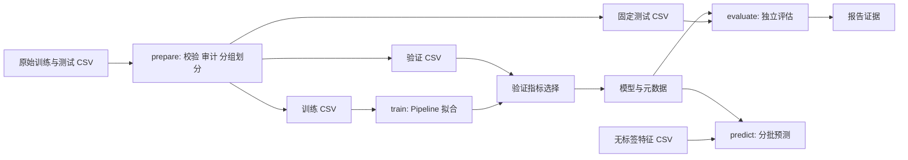
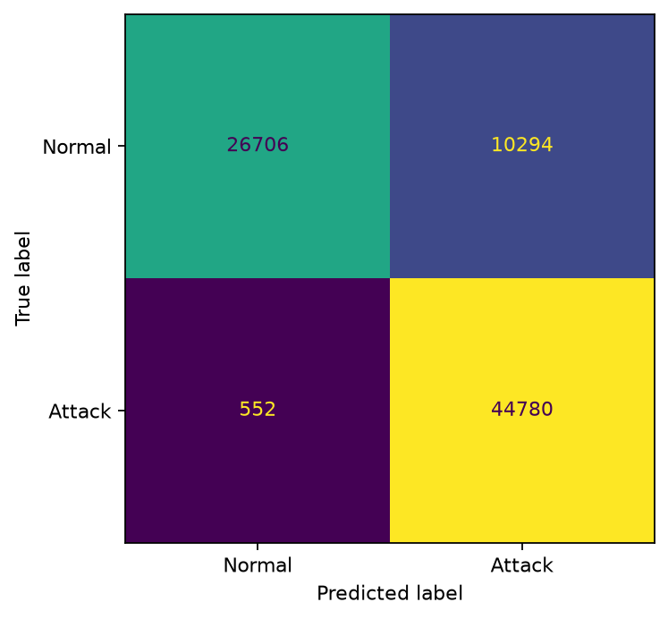
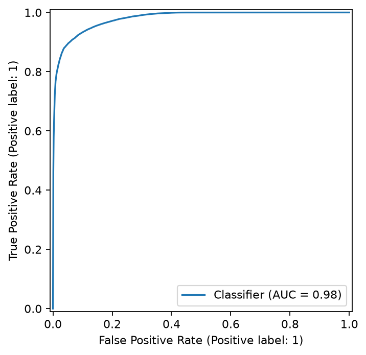
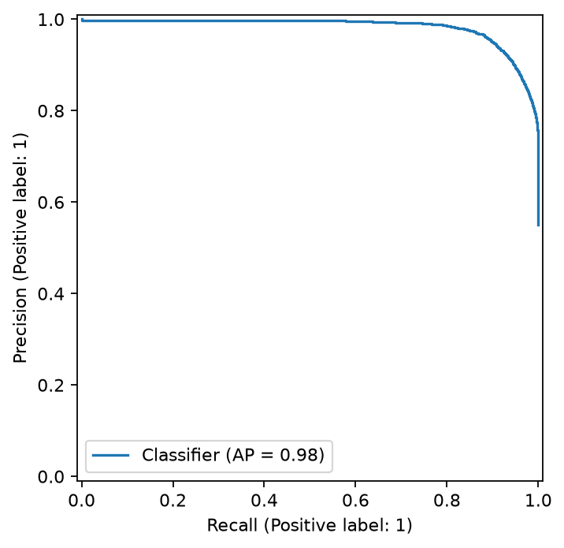

# 基于机器学习的网络流量入侵检测系统的设计与实现

> 历史归档：以下为 2026-11-03 的 scikit-learn 实验，不代表当前 Torch 实现。原指标、链接和运行描述保留用于追溯；其中命令和配置描述应在对应历史代码/锁文件下使用，不能用当前 `configs/full.yaml` 复现旧模型。重构前代码基线为 `c2e94b3ab39be6c0a0bd7f7eb92a23a53747cf75`，具体实验代码哈希见原证据。当前实现与验证进度见 [README.md](README.md)。

课程实验报告，实验日期：2026-11-03。正式证据目录：[results/full-20261103](results/full-20261103/)。本文指标均来自真实 UNSW-NB15 镜像数据运行；环境检查和自动化测试中的合成数据不用于效果结论。

## 1. 摘要与关键词

本项目实现了命令行网络流量入侵检测系统，将输入特征校验、训练集拟合的预处理、分类模型、持久化和独立推理串联为可复现流程。在遵循预定义训练/测试边界的基础上，审计重复特征与冲突标签，使用分层分组划分验证集，对多数类基线、逻辑回归和随机森林进行比较。验证集选出的随机森林在 82,332 条测试记录上获得 Accuracy 86.83%、攻击类 Precision 81.31%、Recall 98.78%、F1 89.20%，误报率为 27.82%。结果说明该配置能够检出大部分攻击，但对正常流量的误报仍明显，尚不能据此认定具备生产部署能力。

关键词：网络入侵检测；UNSW-NB15；随机森林；逻辑回归；数据泄漏；离线推理。

## 2. 问题定义与需求分析

输入为预先提取的网络流量 CSV，每条记录包含 42 个指定特征。输出为正常/攻击二分类标签及攻击概率，攻击为正类。系统须具备可追溯数据处理、可复现训练、独立模型加载、无标签预测、异常输入提示及实验结果留存能力。

系统不采集报文，不计算原始网络特征，不提供图形界面或 Web 接口。离线数据集效果与实时网络检测是不同问题：特征生成的一致性、概念漂移、流量延迟和误报处置均未在本实验验证。

## 3. 数据集、预处理与划分

来源、许可、固定镜像提交、文件哈希、完整字段含义及特征选择依据见 [dataset.md](dataset.md)。官方入口当时要求登录，使用公开镜像已获得用户许可；未经官方字节核验的限制保留在来源清单。镜像训练/测试文件命名相反，本项目按官方划分角色映射，没有直接沿用镜像文件名。

### 原始分布与质量审计

| 集合 | 总数 | 正常 | 攻击 | 重复特征行数（不计每组首行） | 冲突组 / 行 |
|---|---:|---:|---:|---:|---:|
| 原始官方训练角色 | 175341 | 56000 | 119341 | 74301 | 229 / 940 |
| 原始官方测试角色 | 82332 | 37000 | 45332 | 28386 | 6 / 14 |

本次文件未发现缺失值或无穷值，相关检查仍保留在程序和审计中。首次采用严格冲突策略时准备阶段失败，记录见 [initial_prepare_failure.json](results/full-20261103/initial_prepare_failure.json)。检查确认真实数据存在同特征不同标签后，增加并显式启用 `quarantine_development`：隔离训练侧 940 条冲突记录，保留原始行号清单；测试集中的 14 条冲突记录完整保留。

随后从开发集移除与测试集特征完全重叠的 9,768 条记录，得到 164,633 条可用于开发的记录。使用特征指纹作为组，以固定种子 42 的 `StratifiedGroupKFold(n_splits=5)` 第一折形成验证集。同一特征组不能跨训练/验证，同标签组内重复记录保留；因此重复记录的权重影响仍存在。

| 最终集合 | 总数 | 正常 | 攻击 | 用途 |
|---|---:|---:|---:|---|
| 训练 | 131706 | 43237 | 88469 | 拟合全部预处理和分类器 |
| 验证 | 32927 | 10809 | 22118 | 比较候选并冻结选择 |
| 测试 | 82332 | 37000 | 45332 | 选择完成后评估 |

排除 `id`、`label`、`attack_cat`。数值空值与无穷值采用训练集中位数填充，全空列保留并填 0；逻辑回归额外标准化。类别使用固定缺失标记及 One-Hot 编码，未知类别编码为该字段的全零向量并统计。未进行特征选择或过采样。

划分依据、文件哈希及逐字段审计见 [manifest.json](results/full-20261103/data/manifest.json) 和 [audit.json](results/full-20261103/data/audit.json)。缺少会话、主机与时间字段，无法验证这些层面的隔离；测试输入用于重叠审计，但测试标签和分数不参与模型选择。

## 4. 系统设计



数据模块负责字段契约和划分，训练模块负责 Pipeline、模型选择与指标，推理模块只负责加载和预测。公共模块管理安全 YAML、JSON、唯一输出目录、哈希及资源测量。每次运行创建新目录，记录成功或失败，不覆盖既有证据。

模型目录包含完整 `pipeline.joblib` 与 `metadata.json`，后者记录特征顺序、类型、类别映射、阈值、训练配置、依赖版本、模型哈希及数据清单哈希。推理先校验这些信息，重排列顺序；额外列忽略并提示，必需列缺失及类型错误直接报错。

## 5. 模型与实现

使用 scikit-learn `Pipeline` 和 `ColumnTransformer` 将预处理与模型共同保存，避免训练/推理变换不一致。核心接口带类型注解，配置安全加载，未定义指标用 JSON `null` 和原因表示。

| 模型 | 候选设置 | 配置数 |
|---|---|---:|
| Dummy | `strategy=most_frequent` | 1 |
| 逻辑回归 | `C={0.1,1,10}` × `class_weight={None,balanced}`；`lbfgs`，最多 2000 轮 | 6 |
| 随机森林 | 200 棵树；`max_depth={None,20}` × `min_samples_leaf={1,5}`；`max_features=sqrt`、`class_weight=balanced_subsample` | 4 |

候选按固定顺序串行执行；未收敛或异常的候选不参与选择。本次 11 个候选全部成功，逻辑回归未产生收敛警告。选择规则为验证集攻击类 F1 降序、误报率升序、Recall 降序、固定候选顺序；阈值始终为 0.5。

最终选出 `rf-depthNone-leaf1`；逻辑回归族最佳配置为 `C=10, class_weight=None`。模型只在训练集拟合，不把验证集重新合并训练。完整候选指标见 [candidates.json](results/full-20261103/training/candidates.json)，冻结选择见 [selection.json](results/full-20261103/training/selection.json)。

## 6. 实验环境

| 项目 | 实际记录 |
|---|---|
| CPU / 内存 | Apple M1 Pro，8 个逻辑核，16 GiB |
| 系统 / 架构 | macOS 27.2，arm64 |
| Python | 3.12.13 |
| NumPy / SciPy / pandas | 2.5.4 / 1.18.1 / 3.1.0 |
| scikit-learn / joblib | 1.9.1 / 1.6.0 |
| 数值后端 | NumPy BLAS/LAPACK 为 Apple Accelerate |
| 正式线程 / 预测批量 | 最多 4 线程 / 10000 行 |

环境证据见 [environment.json](results/full-20261103/environment.json)、[hardware.json](results/full-20261103/hardware.json) 和 [threadpools.json](results/full-20261103/training/threadpools.json)。`VECLIB_MAXIMUM_THREADS` 在数值库导入前设置，OpenMP 与森林线程同时受控。threadpoolctl 能显示 OpenMP 线程数，但不提供当前 Accelerate 的实际线程池枚举；不能仅据配置声称所有运算都使用了 4 核。

本实验确认了原生架构及数值库后端，没有实施 Rosetta、其他 BLAS 或 GPU 对照，因而不声称具体加速倍数。基线 Git 提交及未提交修改状态被记录，另保存逐个源码文件和锁文件哈希，避免把项目骨架提交误认为完整实现的提交。

## 7. 实验方案与指标

先使用固定合成样本验证程序，再在真实开发数据抽取 5,000 行完成轻量训练与独立加载预测。此阶段不查看正式测试效果。完整候选训练和验证选择完成后，每个模型族的获选配置在独立进程中评估固定测试集。

以攻击为正类，指标定义如下：

- Accuracy = `(TP + TN) / N`。
- Precision = `TP / (TP + FP)`；Recall = `TP / (TP + FN)`。
- F1 = `2TP / (2TP + FP + FN)`；误报率 = `FP / (FP + TN)`。
- 宏平均指标为正常和攻击两类指标的等权平均；任一组成指标未定义时，对应宏平均也标为未定义。
- ROC-AUC 使用连续攻击概率。Average Precision（AP）按召回增量加权精确率计算，不是梯形积分 PR-AUC。

训练耗时覆盖 Pipeline 的 fit。预测吞吐覆盖已校验内存数据上的完整预处理与 `predict_proba`，不含模型加载与 CSV 读写；预热一批后完整预测三次取中位数。加载耗时包括模型哈希检查和反序列化，不包括 Python 进程启动。评估整体耗时另含数据读取、指标计算与图表写入，不能与单次预测耗时相加混用。

内存每 50 ms 采样。当前沙箱拒绝枚举子进程，因此正式值是**当前进程绝对 RSS 峰值**，包含已经加载的数据、解释器和分配器保留内存，不是模型增量内存或整个系统峰值。第一轮资源采集将该限制误处理为空值，修正采样后按完全相同配置重跑；11 个验证指标字典及 3 个测试指标字典均完全一致，见 [rerun_verification.json](results/full-20261103/rerun_verification.json)。重跑未改变超参数、阈值或选择规则。

## 8. 实验结果与分析

### 分类效果

下表均为 0–1 数值，来源：[comparison.csv](results/full-20261103/comparison.csv)。

| 模型 | 验证 F1 | 测试 Accuracy | Precision | Recall | F1 | FPR | Macro F1 | ROC-AUC | AP |
|---|---:|---:|---:|---:|---:|---:|---:|---:|---:|
| Dummy | 0.8036 | 0.5506 | 0.5506 | 1.0000 | 0.7102 | 1.0000 | 0.3551 | 0.5000 | 0.5506 |
| 逻辑回归 | 0.9539 | 0.8113 | 0.7552 | 0.9725 | 0.8502 | 0.3861 | 0.7977 | 0.9561 | 0.9662 |
| 随机森林（获选） | 0.9661 | 0.8683 | 0.8131 | 0.9878 | 0.8920 | 0.2782 | 0.8616 | 0.9794 | 0.9826 |

Dummy 将所有记录判为攻击，所以攻击 Recall 为 1，同时正常类 Recall 为 0、误报率为 1；这说明单看攻击召回率会产生误导。逻辑回归与随机森林均显著改善区分能力，但较高 AUC/AP 不意味着固定阈值下误报足够低。

随机森林验证 F1 为 0.9661，测试 F1 降至 0.8920，下降约 7.41 个百分点。原始训练与测试攻击占比不同，数据划分的分布差异、重复记录权重和实验室流量结构均可能有关；本实验没有隔离这些因素的因果贡献，因此只将其作为局限和后续研究方向。

### 混淆矩阵与错误分析

| 真实类别 / 预测类别 | 正常 | 攻击 |
|---|---:|---:|
| 正常 | 26706（TN） | 10294（FP） |
| 攻击 | 552（FN） | 44780（TP） |



随机森林正常类 Precision / Recall / F1 分别为 0.9797 / 0.7218 / 0.8312；攻击类为 0.8131 / 0.9878 / 0.8920。10,294 条正常流量被误报，意味着该配置不适合直接承担生产告警。552 条漏报中，Fuzzers 占 502 条，其余包括 Exploits 40 条、Shellcode 4 条、DoS 3 条、Reconnaissance 3 条。各攻击类别的统计是在二分类预测上计算的检出比例，不是多分类识别准确率。

完整细分见 [category_breakdown.csv](results/full-20261103/evaluation/random_forest/category_breakdown.csv)。Worms 只有 44 条测试记录，其全部检出不能证明对该类别的稳健泛化能力。原始测试的冲突标签也意味着某些完全同特征记录不可能全部被确定性分类器正确区分。





### 运行成本

| 模型 | 训练秒数 | 训练进程峰值 RSS（MiB） | 加载秒数 | 完整测试预测中位秒数 | 吞吐（行/秒） |
|---|---:|---:|---:|---:|---:|
| Dummy | 0.406 | 593.2 | 0.115 | 0.087 | 947045 |
| 逻辑回归 | 3.345 | 783.5 | 0.107 | 0.106 | 773095 |
| 随机森林 | 28.679 | 979.8 | 0.351 | 0.495 | 166199 |

随机森林三次完整预测耗时约为 0.499、0.495、0.490 秒；预测阶段进程峰值 RSS 约为 638.4 MiB。该模型预测成本高于逻辑回归，但在本测试上有更好的分类效果。各候选顺序训练，RSS 包含可能尚未归还给系统的先前分配，不能据此精确比较模型本身的内存需求。吞吐是批处理离线指标，不是实时链路容量。

## 9. 独立推理与验证

自动化测试覆盖数据隔离、冲突标签、非法类型、未知类别、全空数值列、预处理不泄漏、序列化前后概率及标签一致、错误指标边界、选择排序、候选失败记录和推理文件发布行为。

交付检查结果：`uv sync --locked`、Ruff 检查、Ruff 格式检查、环境检查均成功，`uv run pytest -q` 为 25 项通过。测试中的额外列告警是故意构造的输入行为，不是正式实验错误。报告内本地链接与 Git 差异空白检查也已通过。

真实数据验证移除全部标签与辅助列，只保留 42 个特征，在独立 Python 进程加载 `models/full-20261103-v2/best` 并分批预测全部 82,332 行。验证标签与直接加载模型的结果完全一致、概率在 `atol=rtol=1e-12` 内一致、行顺序完全一致。测试输入存在 5 条训练时未见的 `state` 值，程序统计告警后继续处理。

可使用以下命令复现独立验证，输出目录必须是新的：

```bash
uv run python scripts/verify_inference.py --model models/full-20261103-v2/best --input data/processed/full-20261103/test.csv --output outputs/my-inference-verification
```

验证证据见 [verification.json](results/full-20261103/verification.json)；它验证工程一致性，不额外提供独立数据上的泛化证据。

## 10. 总结与局限

系统已完成数据处理、训练比较、模型保存、独立评估和批量推理闭环，并提供可追溯结果及中文复现说明。当前随机森林在该离线基准上有较高攻击召回率，但误报率仍高，应把结果理解为课程实验而非上线验收。

主要限制包括镜像来源未经官方字节核验；缺少会话/主机/时间隔离证据；保留重复记录造成权重偏差；TCP、TTL 和聚合特征可能依赖采集环境；只使用一个种子和一个数据集；未进行阈值调优、概率校准、多种子统计、消融或真实网络评估。

后续若扩展实验，应在新的预先约定方案中仅用验证数据选择阈值，研究误报约束和召回的权衡，使用独立数据验证并补充时间或主机隔离。不能根据本次测试结果反复调参后仍把同一测试集称为未见数据。

## 11. 参考文献与复现说明

官方要求引用的数据相关资料：

1. Moustafa, N.; Slay, J. *UNSW-NB15: a comprehensive data set for network intrusion detection systems (UNSW-NB15 network data set).* MilCIS, 2015. [IEEE 记录](https://ieeexplore.ieee.org/abstract/document/7348942)。
2. Moustafa, N.; Slay, J. *The evaluation of Network Anomaly Detection Systems: Statistical analysis of the UNSW-NB15 data set and the comparison with the KDD99 data set.* Information Security Journal, 2016. [DOI](https://doi.org/10.1080/19393555.2015.1125974)。
3. Moustafa, N., et al. *Novel Geometric Area Analysis Technique for Anomaly Detection Using Trapezoidal Area Estimation on Large-Scale Networks.* IEEE Transactions on Big Data，官方数据页列为 2017 年在线资料。[IEEE 记录](https://ieeexplore.ieee.org/abstract/document/7948715)。
4. Moustafa, N.; Creech, G.; Slay, J. *Big Data Analytics for Intrusion Detection System: Statistical Decision-Making Using Finite Dirichlet Mixture Models.* 2017, pp. 127–156. [Springer](https://link.springer.com/chapter/10.1007/978-3-319-59439-2_5)。
5. Sarhan, M.; Layeghy, S.; Moustafa, N.; Portmann, M. *NetFlow Datasets for Machine Learning-based Network Intrusion Detection Systems.* [arXiv:2011.09144](https://arxiv.org/abs/2011.09144)。本项目使用原始划分特征 CSV，未改用该文的 NetFlow 版本。

工具与方法： [scikit-learn 用户指南](https://scikit-learn.org/stable/user_guide.html)、[Average Precision 定义](https://scikit-learn.org/stable/modules/generated/sklearn.metrics.average_precision_score.html)、[Apple Accelerate](https://developer.apple.com/accelerate/)。部分出版商页面在本次网络访问中限制自动抓取，文献题名和链接由官方数据页交叉核对；未声称阅读受限全文。

复现从根目录 [README](../README.md) 的安装、下载、小样本、正式训练与评估命令开始。当前报告使用：

```text
配置：configs/full.yaml
划分：data/processed/full-20261103
训练：models/full-20261103-v2
评估：outputs/full-20261103-v2
报告：reports/results/full-20261103
```

精简证据包含配置、依赖环境、数据/模型哈希、代码哈希、所有候选验证指标、各模型族测试指标和图表。大体积原始数据、处理数据、模型二进制及错误逐行明细保留在被 Git 忽略的目录，通过文档命令重新生成；报告引用的精简材料随仓库保留。实验生成时尚未提交实现，记录中的 Git 基线不是最终交付提交；最终提交请以仓库历史为准。

训练完成后仅调整了混淆矩阵图片的数字显示格式，使其显示完整整数；未改动指标计算、模型或选择。记录见 [post_training_changes.json](results/full-20261103/post_training_changes.json)。
